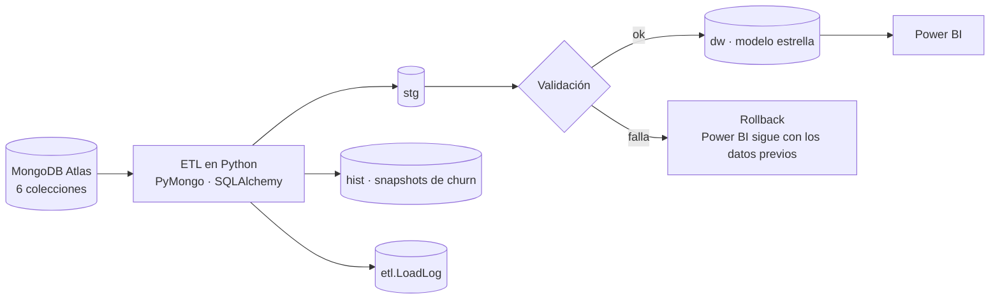

# Fitness Life — ETL y Data Warehouse

Proceso ETL que lleva los datos operacionales de **Fitness Life** (una app de gestión de gimnasio) desde MongoDB Atlas hasta un **Data Warehouse en Azure SQL** con modelo estrella, para alimentar un dashboard de **Power BI** con asistencia, pagos, clases y predicción de abandono (*churn*).

## Puntos clave

- **Publicación atómica:** cada corrida carga en `stg`, valida y reemplaza `dw` en una sola transacción. Si algo falla, nada cambia para el dashboard.
- **Validaciones que bloquean datos malos:** colecciones vacías, más del 1 % de referencias huérfanas, conteos que no cuadran o una caída brusca de volumen.
- **Idempotente:** re-ejecutar no duplica datos.
- **Histórico de predicciones** de abandono que nunca se borra, para analizar su evolución.
- **Privacidad:** nunca extrae contraseñas, tokens ni firmas de pago, y los errores no exponen datos personales.
- **Automatizado:** GitHub Actions lo corre cuatro veces al día.
- **Verificado contra el dashboard original:** los ingresos y el mapa de calor de accesos coinciden exactamente.

📘 Documentación completa (modelo estrella, reglas de transformación y operación): [`etl/README.md`](etl/README.md)

---

Proyecto académico · Desarrollado por **[Samuel Alzate](https://github.com/Samuel3945)**
